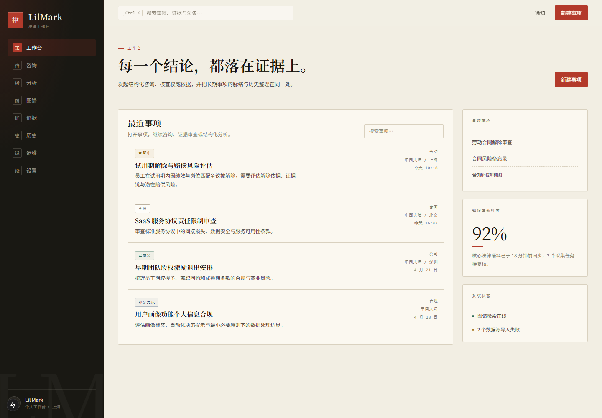
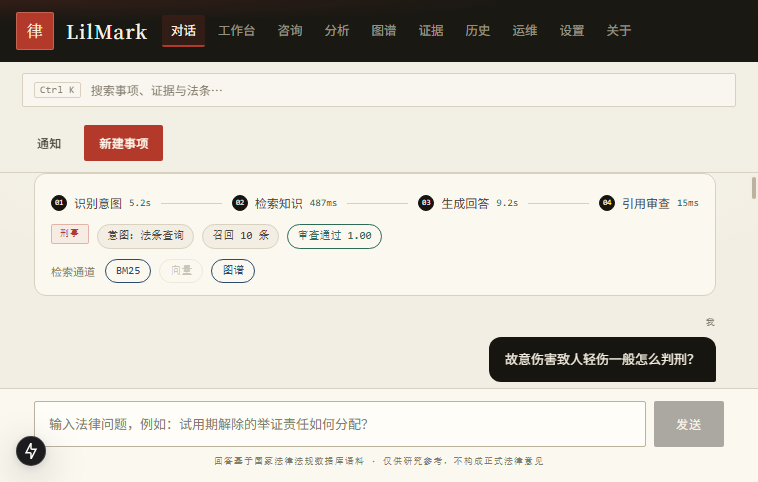
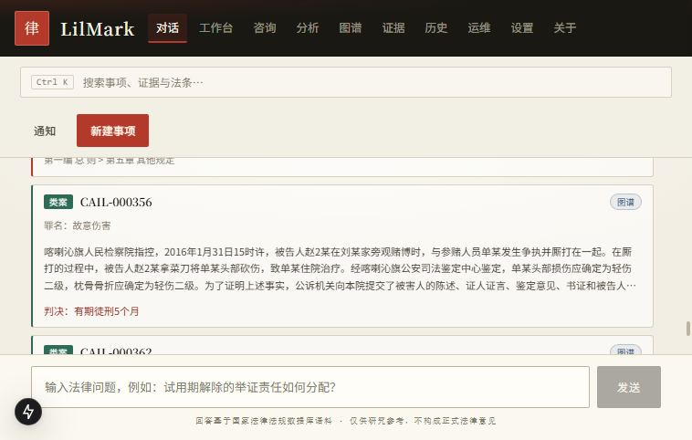
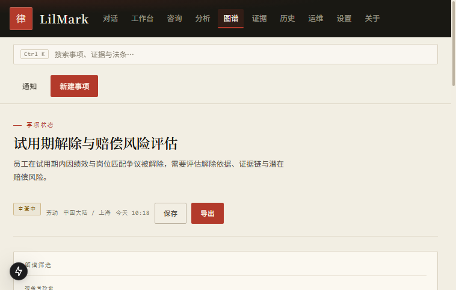
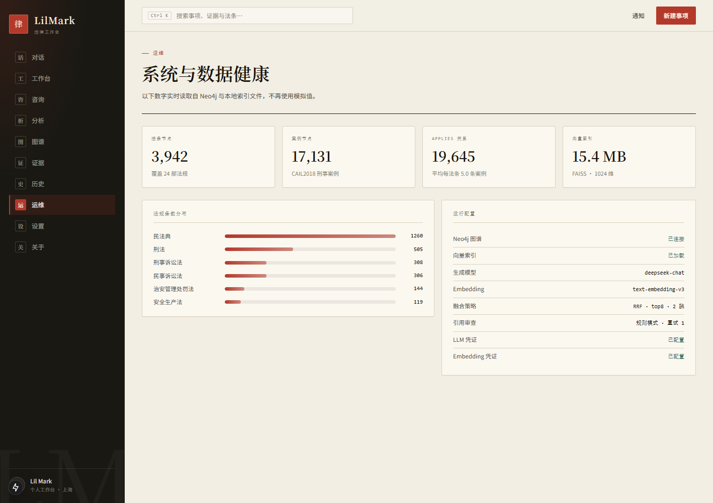

# Law Agent RAG

**基于多智能体协作与 GraphRAG 的智能法律咨询助手**

> LangGraph 编排 · BM25 + FAISS + Neo4j 三路检索 · 结构化引用溯源 · SSE 全流程可观测

[](https://www.python.org/)
[](https://fastapi.tiangolo.com/)
[](https://nextjs.org/)
[](https://neo4j.com/)
[](https://langchain-ai.github.io/langgraph/)
[](LICENSE)

<p align="center">
  
  <br>
  <em>工作台 · 纸本案卷式界面</em>
</p>

<table>
  <tr>
    <td width="50%"><br><em>多智能体编排时间线：逐节点状态与真实耗时</em></td>
    <td width="50%"><br><em>结构化引用溯源：法条章节 / 案号 / 罪名 / 判决 / 检索通道</em></td>
  </tr>
  <tr>
    <td width="50%"><br><em>真实 Neo4j 子图：法条 + 适用案例 + 二跳关联</em></td>
    <td width="50%"><br><em>运维面板：图谱规模、法规分布、索引与模型状态</em></td>
  </tr>
</table>

---

## ✨ 核心特性

- 🧠 **多 Agent 协作** — 基于 LangGraph 的协调-领域-审查三层 Agent 架构，自动识别法律领域并路由到专业 Agent；审查不通过触发**反思回边**重新生成
- 🔍 **GraphRAG 混合检索** — BM25 + 向量检索（FAISS）+ 知识图谱检索（Neo4j）三路召回，加权 RRF 融合，图谱支持二跳扩展
- 🏛️ **多领域覆盖** — 民法、刑法、劳动法、行政法 + 通用法律咨询，支持领域扩展
- 📚 **结构化引用溯源** — 回答附可展开的来源卡片：法条给出法名/条号/章节，类案给出案号/罪名/事实/判决，并标注每条命中的检索通道
- ⚡ **SSE 流式可观测** — 逐步推送意图识别 → 检索 → 生成 → 审查，前端渲染时间线并显示**每步真实耗时**，瓶颈一目了然
- 🕸️ **真实图谱浏览** — 图谱页从 Neo4j 实时拉取子图（法条 + 适用案例 + 二跳关联），力导向布局可视化，非静态示意图
- 📊 **真实运维面板** — 图谱规模、法规条数分布、索引体积、模型与审查配置全部实时读取，绝不回传密钥
- 🔧 **配置驱动** — Agent 提示词、检索参数、模型配置全部 YAML 管理，无需改代码

## 🛠️ 技术栈

| 层级 | 技术 | 说明 |
|------|------|------|
| **LLM** | DeepSeek（deepseek-chat） | OpenAI 兼容 API，可替换任意同协议模型 |
| **Embedding** | text-embedding-v3 (DashScope) | 阿里云文本嵌入，1024 维 |
| **Agent 框架** | LangGraph | StateGraph 多节点工作流编排 |
| **向量存储** | FAISS | 本地向量索引，相似度检索 |
| **图数据库** | Neo4j 5 | 法律法规-案例知识图谱 |
| **后端** | FastAPI + SSE | 异步 REST API，流式事件推送 |
| **前端** | Next.js 15 + TypeScript | App Router，Tailwind CSS 4 |
| **数据处理** | Python 3.11+ | 法条解析、案例结构化 |
| **包管理** | uv | Python 依赖管理 |

## 📁 项目结构

```
Law_Agent_RAG/
├── backend/                    # FastAPI 后端
│   ├── main.py                 # 服务入口，CORS，路由注册
│   ├── config.py               # 路径引导（复用 src/config.py）
│   ├── routers/
│   │   ├── chat.py             # POST /api/chat SSE 流式端点
│   │   ├── graph.py            # GET /api/graph/{stats,subgraph} 真实子图
│   │   ├── system.py           # GET /api/system/stats 运维真实统计
│   │   └── health.py           # GET /api/health 健康检查
│   └── services/
│       └── streamer.py         # SSE 事件构造器（含结构化溯源）
├── frontend/                   # Next.js 前端
│   ├── app/                    # App Router 页面
│   │   ├── page.tsx            # / → 重定向到 /workspace
│   │   ├── workspace/          # /workspace 主工作区
│   │   ├── about/              # /about 项目介绍
│   │   ├── history/            # /history 历史记录
│   │   └── settings/           # /settings 设置
│   ├── components/
│   │   ├── shell/              # AppShell 统一外壳（侧栏 + 顶栏 + 内容区）
│   │   ├── chat/               # 对话流、编排时间线、引用来源卡片
│   │   ├── consultation/       # 咨询对话组件
│   │   ├── evidence/           # 证据/法条面板
│   │   ├── graph/              # 力导向子图渲染
│   │   └── matter/             # 案件头部信息
│   └── lib/                    # 类型定义、路由、工具
├── src/                        # 核心共享模块
│   ├── agents/                 # Agent 层
│   │   ├── coordinator.py      # 协调 Agent（意图识别 + LangGraph 路由）
│   │   ├── domain_agent.py     # 领域 Agent 基类
│   │   ├── reviewer.py         # 审查 Agent（质量校验）
│   │   └── config/             # 各领域 YAML 提示词配置
│   │       ├── civil_law.yaml
│   │       ├── criminal_law.yaml
│   │       ├── labor_law.yaml
│   │       ├── admin_law.yaml
│   │       └── general.yaml
│   ├── retrieval/              # GraphRAG 检索层
│   │   ├── vector_search.py    # FAISS 向量检索引擎
│   │   ├── graph_search.py     # Neo4j 图检索 + 实体抽取
│   │   ├── fusion.py           # 多路结果融合 + hybrid_search() 入口
│   │   └── rag.py              # RAG 编排（检索 → Prompt → LLM）
│   ├── data/                   # 数据层
│   │   ├── collector.py        # 数据采集（法条语料 + 内置示例）
│   │   ├── cail_loader.py      # CAIL2018 案例解析（多法条 / 刑期归一化）
│   │   ├── processor.py        # 法条/案例结构化处理
│   │   └── kg_builder.py       # Neo4j 知识图谱构建
│   ├── app/
│   │   └── main.py             # Streamlit UI（经典版）
│   └── config.py               # YAML 配置加载器
├── config/
│   └── settings.yaml           # 全局配置（模型、检索、Neo4j）
├── tests/                      # 单元测试（pytest，103 个用例）
├── scripts/
│   ├── fetch_laws.py           # 法条语料采集
│   ├── import_sample_data.py   # 法条 → Neo4j
│   ├── import_cail.py          # CAIL 刑事案例 → Neo4j
│   ├── build_index.py          # 构建 FAISS 向量索引
│   ├── eval_retrieval.py       # 检索评测（Recall@K / MRR）
│   └── doctor.py               # 环境自检
├── docs/
│   ├── assets/                 # 界面截图
│   ├── deployment/             # 部署与排错
│   ├── onboarding/             # 数据接入与改造方案
│   └── superpowers/            # 设计文档与实施计划
├── pyproject.toml              # Python 项目配置
└── README.md
```

## 🚀 快速开始

### 前置要求

- Python 3.11+（推荐用 [uv](https://docs.astral.sh/uv/) 管理，`uv sync` 会自动装 3.11）
- Node.js 20+
- Docker（跑 Neo4j 5）
- DeepSeek API Key（[获取地址](https://platform.deepseek.com/)）— 生成回答必需
- DashScope API Key（[获取地址](https://bailian.console.aliyun.com/)）— 仅 Embedding，缺失时自动降级为 BM25

### 1. 安装依赖

```bash
uv sync                    # Python 依赖（自动创建 .venv）
cd frontend && npm install && cd ..
```

### 2. 启动 Neo4j

```bash
docker compose up -d       # 使用项目内的 docker-compose.yml
docker compose ps          # 等到 health 变成 healthy
```

控制台：http://localhost:7474 ｜ Bolt：`bolt://localhost:7687`

### 3. 配置环境变量

```bash
cp .env.example .env       # 填入两个 Key 与 NEO4J_PASSWORD
```

`.env` 已被 git 忽略；优先级为 **`.env` > 系统环境变量 > `config/settings.yaml`**——改配置就改 `.env`，免得系统里一个残留的旧 Key 静默盖掉它。

### 4. 初始化数据

```bash
uv run python scripts/import_sample_data.py   # 3942 条法条 → Neo4j
uv run python scripts/import_cail.py          # 可选：17,131 条 CAIL 刑事案例 → 图谱
uv run python scripts/build_index.py          # 可选：构建 FAISS 向量索引（需 Embedding Key）
uv run python scripts/doctor.py --check-api   # 自检：环境 / Key / 语料 / 图谱
```

> `import_cail.py` 需要先准备 `data/raw/cail/data_valid.json`，
> 获取方式与字段说明见 [docs/onboarding/CAIL案例接入方案.md](docs/onboarding/CAIL案例接入方案.md)。
> 不导入也能跑，只是图谱里只有法条、没有类案。

### 5. 启动后端

```bash
uv run uvicorn backend.main:app --reload --port 8000
# 或 cd backend && uv run python main.py
```

### 6. 启动前端

```bash
cd frontend && npm run dev
# Next.js 运行在 http://localhost:3000
```

### 7. 打开浏览器

访问 **http://localhost:3000** 开始使用。

> 💡 经典 Streamlit 版也可独立运行：
> ```bash
> uv run streamlit run src/app/main.py
> ```

> 📖 完整部署与排错见 [docs/deployment/本地部署指南.md](docs/deployment/本地部署指南.md)


## 🔑 环境变量

| 变量名 | 说明 | 必需 |
|--------|------|:----:|
| `DEEPSEEK_API_KEY` | DeepSeek API 密钥（LLM 对话） | ✅ |
| `DASHSCOPE_API_KEY` | 阿里云 DashScope API 密钥（Embedding） | ✅ |
| `NEO4J_PASSWORD` | Neo4j 数据库密码 | ✅ |

所有配置也可直接在 `config/settings.yaml` 中设置，环境变量优先级更高。

## 📖 使用方法

### Web 界面

1. 打开前端页面，进入工作区（`/workspace`）
2. 在输入框中输入法律问题，例如：
   - "劳动合同未签订，如何维权？"
   - "故意伤害罪的量刑标准是什么？"
   - "行政处罚不服怎么办？"
3. 系统自动识别法律领域，实时展示检索和生成过程
4. 查看 AI 回答及引用的法条/案例来源

### Python API

```python
from src.agents.coordinator import ask_agent

result = ask_agent(
    question="劳动者未签劳动合同怎么维权？",
    history=[]  # 可选：多轮对话历史
)

print(result["answer"])      # AI 回答
print(result["sources"])     # 引用来源
print(result["domain"])      # 识别的法律领域
print(result["domain_zh"])   # 领域中文名
```

### REST API

```bash
curl -X POST http://localhost:8000/api/chat \
  -H "Content-Type: application/json" \
  -d '{"question": "用人单位不签劳动合同怎么办？", "history": []}'
```

响应为 SSE 事件流（`elapsed_ms` 为从请求开始的累计毫秒，前端相邻相减得到每步耗时）：

```
event: step
data: {"step":"intent","status":"completed","domain":"labor_law","domain_zh":"劳动","intent":"法条查询","elapsed_ms":4913}

event: step
data: {"step":"retrieve","status":"completed","sources_count":8,"retrieved_by":["bm25","vector","graph"],"elapsed_ms":5729}

event: step
data: {"step":"generate","status":"completed","answer":"根据《中华人民共和国劳动合同法》…","elapsed_ms":14760}

event: step
data: {"step":"review","status":"completed","passed":true,"score":0.94,"mode":"rule","elapsed_ms":14772}

event: done
data: {"sources":["中华人民共和国劳动合同法 第十条","…"],
       "sources_detail":[
         {"type":"law","law_name":"中华人民共和国劳动合同法","article_number":"第十条","chapter_path":"第二章 劳动合同的订立","retrieved_by":"bm25"},
         {"type":"case","case_id":"CAIL-000356","crime":"故意伤害罪","fact":"被告人…","judgment":"有期徒刑五个月","retrieved_by":"graph"}
       ]}
```

### API 端点

| 方法 | 路径 | 说明 |
|------|------|------|
| `POST` | `/api/chat` | 提问，SSE 流式返回 intent → retrieve → generate → review → done |
| `GET` | `/api/health` | 服务健康检查 |
| `GET` | `/api/graph/stats` | 图谱规模：法条 / 案例 / APPLIES 关系数 |
| `GET` | `/api/graph/subgraph?article=第二百六十四条&law=刑法` | 按条号 + 法名收窄取子图（命中法条 + 适用案例 + 二跳关联） |
| `GET` | `/api/system/stats` | 运维面板数据：图谱统计、法规分布、索引体积、模型与审查配置 |

> `law` 参数不是可选项：24 部法规的条号天然重名，「第二百六十四条」既可能是刑法盗窃罪、也可能是民法典合同编，图检索必须带法名收窄。

## 🧩 核心模块说明

### Agent 层 (`src/agents/`)

| 模块 | 职责 |
|------|------|
| **Coordinator** | 基于 LLM 的意图识别（领域 + 意图 + 关键词），通过 LangGraph `StateGraph` 构建多 Agent 工作流，条件路由到对应领域 Agent |
| **DomainAgent** | 领域 Agent 基类，加载领域 YAML 配置中的 system prompt，调用 hybrid_search → LLM 生成专业回答 |
| **Reviewer** | 审查 Agent，检查法条引用完整性、准确性、免责声明，返回通过/不通过及评分 |

**Agent 路由流程：**

```
用户问题 → identify_intent 节点
              ↓ (条件路由)
    civil_law / criminal_law / labor_law / admin_law / general
              ↓
         DomainAgent.answer()
              ↓
          最终回答
```

### 检索层 (`src/retrieval/`)

- **VectorSearchEngine** — 基于 DashScope embedding + FAISS 的语义向量检索
- **graph_search** — LLM 实体抽取 → Cypher 查询 → Neo4j 2-hop 遍历，关联法规与案例
- **fusion.hybrid_search()** — 统一检索入口，三路各深召回 20 条 → 加权 RRF 融合 → Top-K 输出（权重：向量 1.0 / BM25 0.2 / 图 0.5，rrf_k=60）

### 数据层 (`src/data/`)

- **collector** — CAIL 数据集下载 + 5 条内置示例法条 + 3 条内置案例（开发测试用）
- **processor** — 法条文本拆分为 法-章-条 三级结构；案例统一化处理
- **kg_builder** — Neo4j MERGE 节点（Law / Case） + APPLIES 关系边，支持批量导入

## 📈 检索质量评测

33 条 gold（法名 + 条号粒度），`scripts/eval_retrieval.py` 可一键复现：

| 配置 | Recall@5 | MRR | 单查询耗时 |
|---|---|---|---|
| 字符二元组兜底（改造前） | 0.545 | 0.336 | 102 ms |
| BM25 单路 | 0.727 | 0.482 | 23 ms |
| 向量单路 | 0.848 | 0.733 | 404 ms |
| 等权 RRF（浅召回 5/8） | 0.818 | 0.692 | 237 ms |
| **加权 RRF（深召回 20/20）** | **0.879** | **0.741** | 449 ms |

两个反直觉结论，都写进了 `config/settings.yaml` 的注释：

1. **等权融合会低于单路最优**（0.818 < 0.848）——弱通道的"噪声提名"与强通道的有效提名等权累加，反而把正确答案挤下去；降权到 `vector 1.0 / bm25 0.2` 才有增益。
2. **必须先深召回再截断**——每路只取 5 条就融合，两路结果几乎重合，融合等于白做；各取 20 条后 Recall 从 0.848 升到 0.879。

```bash
uv run python scripts/eval_retrieval.py --mode vector --top-k 5
uv run python scripts/eval_retrieval.py --mode hybrid --top-k 5
uv run python scripts/eval_retrieval.py --mode hybrid --no-graph   # 消融：看图检索贡献
uv run python scripts/sweep_fusion.py --depth 20                   # 权重扫描
```

## 🔧 开发指南

### 运行测试

```bash
# 运行所有测试
uv run pytest tests/ -v

# 运行单个测试
uv run pytest tests/test_coordinator.py -v

# 带覆盖率
uv run pytest tests/ -v --cov=src --cov-report=html
```

### 测试文件

| 文件 | 覆盖模块 |
|------|----------|
| `test_coordinator.py` | 意图识别、LangGraph 路由 |
| `test_graph.py` | 编排图结构与审查条件回边 |
| `test_domain_agent.py` | 领域 Agent 回答生成、上下文与溯源构造 |
| `test_reviewer.py` | 审查质量校验 |
| `test_vector_search.py` | FAISS 索引与查询 |
| `test_graph_search.py` | 实体抽取、Cypher 查询 |
| `test_fusion.py` | 多路融合、案例留位、去重排序 |
| `test_kg_builder.py` | Neo4j 节点/关系构建、多法条解析 |
| `test_cail_loader.py` | CAIL 案例解析、刑期三态归一化 |
| `test_law_parser.py` | 法条 法-章-条 三级结构解析 |
| `test_processor.py` | 法条文本解析与案例结构化 |
| `test_streamer.py` | SSE 事件构造（含结构化溯源） |

### 添加新领域

1. 在 `src/agents/config/` 创建 `new_domain.yaml`，参照 `civil_law.yaml` 格式
2. 在 `src/agents/coordinator.py` 的 `DOMAINS` 列表和 `DOMAIN_MAP` 中添加映射
3. 在 `config/settings.yaml` 的 `agents.domains` 中添加领域名

### 前端开发

```bash
cd frontend
npm run dev     # 开发模式（热更新）
npm run build   # 生产构建
npm run lint    # 代码检查
```

前端通过 Next.js rewrites 将 `/api/*` 代理到后端 `localhost:8000`，开发时无需额外配置。

## 🚢 部署

### 本地部署

```bash
# 1. 构建前端
cd frontend && npm run build

# 2. 启动后端（生产模式）
cd backend && uvicorn main:app --host 0.0.0.0 --port 8000

# 3. 启动前端
cd frontend && npm start
```

### Docker 部署

`docker-compose.yml` 目前只容器化 Neo4j（应用本体仍本地启动），应用容器化待补。

### 注意事项

- Neo4j 需要持久化数据卷
- API Key 通过环境变量注入，不要硬编码到配置文件中
- 生产环境建议配置 Nginx 反向代理
- 前端 SSR 需要 Node.js 运行时环境

## 🗺️ Roadmap

- [x] Multi-Agent 协调架构（LangGraph）
- [x] GraphRAG 三路混合检索
- [x] Streamlit 经典 UI
- [x] FastAPI + SSE 流式后端
- [x] Next.js 15 现代化前端
- [x] 多领域法律咨询（民法/刑法/劳动法/行政法）
- [x] 审查 Agent 质量校验 + 反思回边重生成
- [x] CAIL 刑事案例接入（17,131 条判例 / 19,645 条案例-法条关联）
- [x] 多轮对话（指代消解，history 传入编排链路）
- [x] 编排时间线（逐节点状态 + 真实耗时）
- [x] 结构化引用溯源（法条章节 / 案号 / 罪名 / 判决 / 检索通道）
- [x] 真实 Neo4j 子图渲染（替换硬编码示意图）
- [x] 运维面板真实统计（图谱 / 索引 / 模型配置）
- [ ] CAIL 全量导入（270 万条，需先换 fulltext index 检索）
- [ ] 类案检索评测（按罪名标注算 Recall@K）
- [ ] Docker 一键部署
- [ ] 对话历史持久化
- [ ] 用户认证与多租户
- [ ] 法律文书生成
- [ ] 移动端 PWA 支持
- [ ] 向量索引增量更新

## 📄 License

本项目采用 [MIT License](LICENSE) 开源。

---

<p align="center">
  <sub>Original project by <a href="https://github.com/qscoder23">qscoder23</a> · Rebuilt and restyled as LilMark</sub>
</p>
